<p align="center">
  
</p>

<p align="center">
  <a href="https://github.com/JinsuBae2?tab=repositories"><strong>Explore repositories</strong></a>
  &nbsp; / &nbsp;
  <a href="https://github.com/JinsuBae2/y-sync">Y-Sync</a>
  &nbsp; / &nbsp;
  <a href="https://github.com/JinsuBae2/docflow">Docflow</a>
</p>

## `❯ whoami`

**안녕하세요, 배진수입니다.** 아이디어를 직접 구현하고, 배포하고, 운영하며 배우는 개발자입니다.

**Spring Boot**를 중심으로 백엔드 역량을 쌓고 있습니다. API를 만드는 것에서 한 걸음 더 나아가, **AWS · Oracle Cloud · Docker · Nginx**로 서비스가 실제로 돌아가는 과정까지 경험하고 있습니다.

```yaml
focus:      Backend development & cloud infrastructure
approach:   Learn by building, grow through collaboration
next:       Stronger fundamentals, better services
```

## `❯ ls ~/projects`

<table>
  <tr>
    <td width="50%" valign="top">
      <h3><a href="https://github.com/JinsuBae2/y-sync">Y-Sync</a></h3>
      <p><strong>Campus, connected.</strong></p>
      <p>학과 공지, 커뮤니티, 시간표를 한곳에.<br>학생을 위한 학사 정보·커뮤니티 서비스.</p>
      <p><code>Spring Boot</code> <code>Flutter</code><br><code>MySQL</code> <code>Oracle Cloud</code></p>
      <a href="https://github.com/JinsuBae2/y-sync">저장소 보기</a>
    </td>
    <td width="50%" valign="top">
      <h3><a href="https://github.com/JinsuBae2/Pet-Ready">Pet-Ready</a></h3>
      <p><strong>Care before adoption.</strong></p>
      <p>로봇강아지와 함께하는 반려견 양육 체험.<br>Spring Boot 백엔드와 Jetson Nano 비전 담당.</p>
      <p><code>Spring Boot</code> <code>MariaDB</code><br><code>YOLO</code> <code>Jetson Nano</code></p>
      <a href="https://github.com/JinsuBae2/Pet-Ready">저장소 보기</a>
    </td>
  </tr>
  <tr>
    <td width="50%" valign="top">
      <h3><a href="https://github.com/JinsuBae2/docflow">Docflow</a></h3>
      <p><strong>Ideas into documents.</strong></p>
      <p>아이디어, 기획 문서, 사용자 흐름을 연결하는<br>AI 기반 로컬 워크스페이스. 초기 개발 버전.</p>
      <p><code>Markdown</code> <code>Electron</code><br><code>AI</code> <code>Mermaid</code></p>
      <a href="https://github.com/JinsuBae2/docflow">저장소 보기</a>
    </td>
    <td width="50%" valign="top">
      <h3><a href="https://github.com/JinsuBae2/saferoute">SafeRoute</a></h3>
      <p><strong>Rethinking evacuation guidance.</strong></p>
      <p>화재 관측에 따라 대피 경로와 유도등 방향을<br>바꾸는 제어 시스템. 개발·시뮬레이션 검증 중.</p>
      <p><code>Python</code> <code>TypeScript</code><br><code>Control API</code> <code>Simulation</code></p>
      <a href="https://github.com/JinsuBae2/saferoute">저장소 보기</a>
    </td>
  </tr>
</table>

## `❯ cat toolbox.conf`

| | Technologies |
| :--- | :--- |
| **Backend** | `Java` `Spring Boot` |
| **Languages** | `Java` `Dart` `Python` |
| **Frontend & Mobile** | `Flutter` `React` |
| **Infrastructure** | `AWS` `Oracle Cloud` `Docker` `Nginx` `Linux` |
| **Tools** | `Git` `GitHub` |

## `❯ cat journey.log`

| Track | Experience |
| :--- | :--- |
| **Education** | 영남이공대학교 소프트웨어융합과 재학 |
| **Leadership** | 소프트웨어융합과 학회장 |
| **Community** | SW Pilot 4기 |
| **AI** | LG Aimers 9기 |

<details>
<summary><strong>❯ cat goals.md</strong></summary>

- 탄탄한 기본기를 갖춘 개발자로 성장하기
- 협업을 통해 완성도 높은 서비스 만들기
- 배운 내용을 프로젝트에 적용하고 기록하기
- 사용자에게 도움이 되는 소프트웨어 개발하기

</details>

<br>

---

<p align="center">
  <code>❯ echo "Thanks for stopping by. See you in the next commit."</code>
  <br><br>
  <a href="https://github.com/JinsuBae2"><strong>@JinsuBae2</strong></a>
</p>
